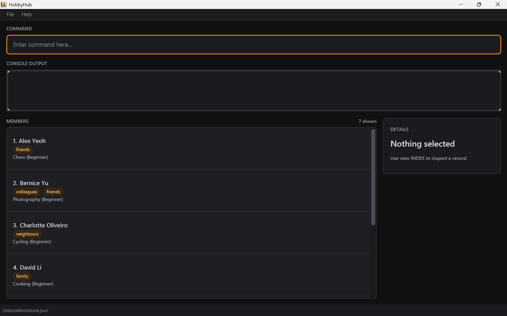

 

# HobbyHub

HobbyHub is a desktop app for hobby club coordinators to manage **members** and **club sessions**, optimised for use
through a Command Line Interface (CLI) while keeping the benefits of a JavaFX GUI.

It keeps each member's hobbies and skill levels, groups, weekday availability and optional contact details in one
local, human-readable data file, and records which members are assigned to each session.

## Features

* Add, edit, view and delete members and sessions (`list -m` / `list -s` switches between the two lists).
* Multi-criteria search for members (name, hobby, skill level, group, email, availability) and sessions
  (name, location, date, completion, member email).
* Assign and unassign members to sessions, and mark sessions as completed.
* Automatic saving after every successful command, with invalid data entries skipped on startup.

## Documentation

* [Product website](https://ay2627s1-cs2103t-t17-4.github.io/tp/)
* [User Guide](https://ay2627s1-cs2103t-t17-4.github.io/tp/UserGuide.html)
* [Developer Guide](https://ay2627s1-cs2103t-t17-4.github.io/tp/DeveloperGuide.html)
* [About Us](https://ay2627s1-cs2103t-t17-4.github.io/tp/AboutUs.html)

## Getting started

Requires Java 25 or later. Download the latest `hobbyhub.jar` from
[Releases](https://github.com/AY2627S1-CS2103T-T17-4/tp/releases), put it in an empty folder, and run
`java -jar hobbyhub.jar` from a terminal in that folder.

## Acknowledgements

This project is based on the [AddressBook-Level3 project](https://github.com/se-edu/addressbook-level3) created by the
[SE-EDU initiative](https://se-education.org).

HobbyHub also uses [JavaFX](https://openjfx.io/), [Jackson](https://github.com/FasterXML/jackson),
[JUnit 5](https://junit.org/junit5/), Gradle, and the [JaCoCo](https://www.jacoco.org/jacoco/) code-coverage tool.
