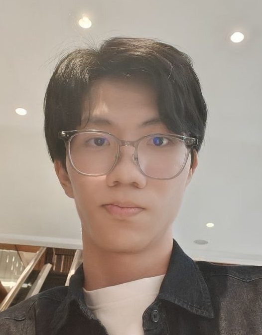
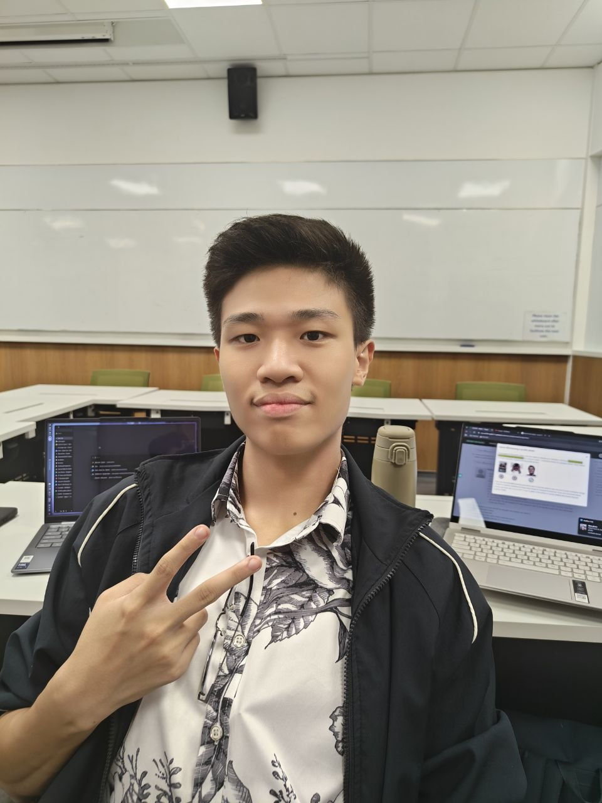
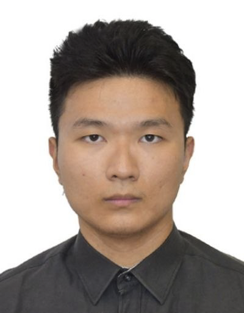
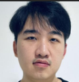
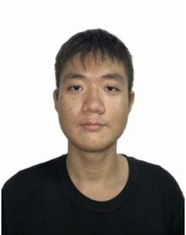

We are a team based in the [School of Computing, National University of Singapore](https://www.comp.nus.edu.sg).

## Project team

### Asher Ng

[[github](https://github.com/AsherNg)]

* Role: Project Advisor
* Responsibilities: Documentation

### Dylan Tay

[[github](http://github.com/zsdcode)]

* Role: Team Lead
* Responsibilities: Testing

### Ni Jian

[[github](http://github.com/nijian3369)]

* Role: Developer
* Responsibilities: Deliverables and deadlines

### Darryl

[[github](http://github.com/Dzdizzy)]

* Role: Developer
* Responsibilities: UI

### Hong Zhi

[[github](http://github.com/chzzzzzzzzzz)]

* Role: Developer
* Responsibilities: Code quality
