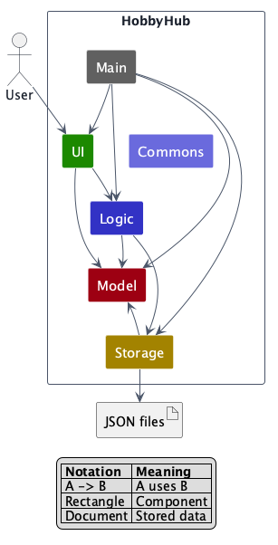
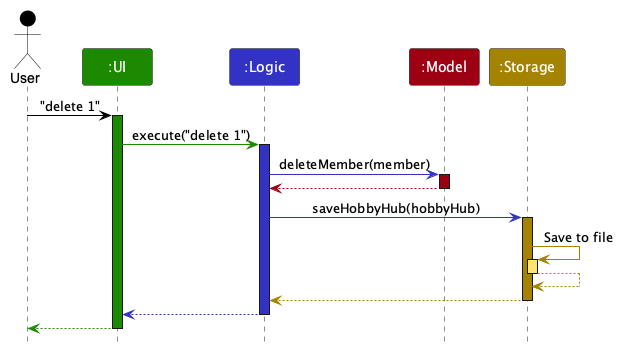
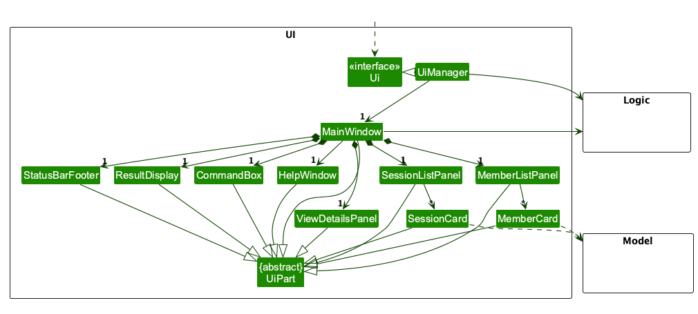
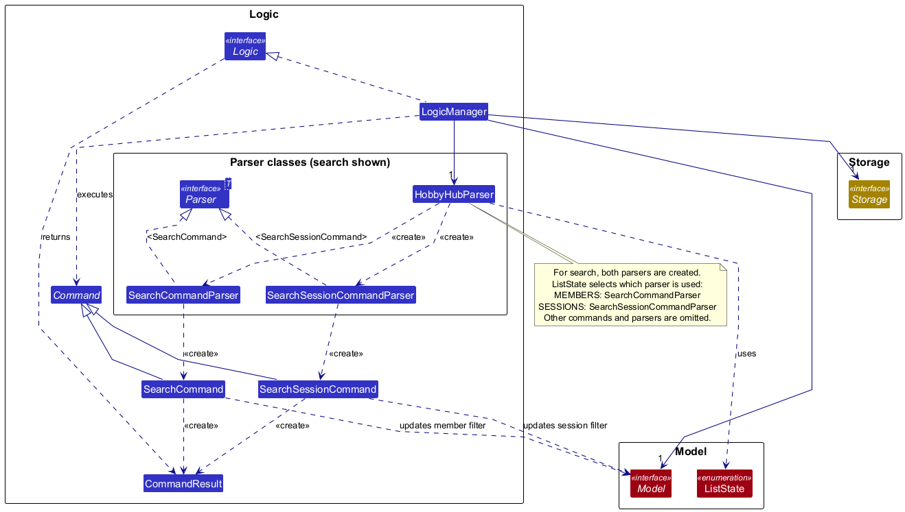
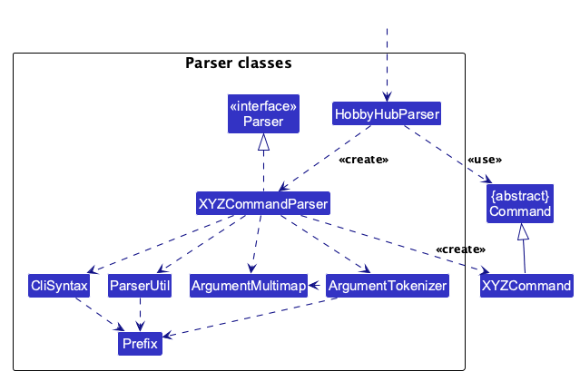
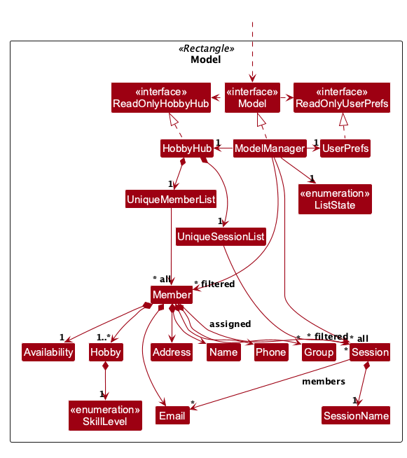
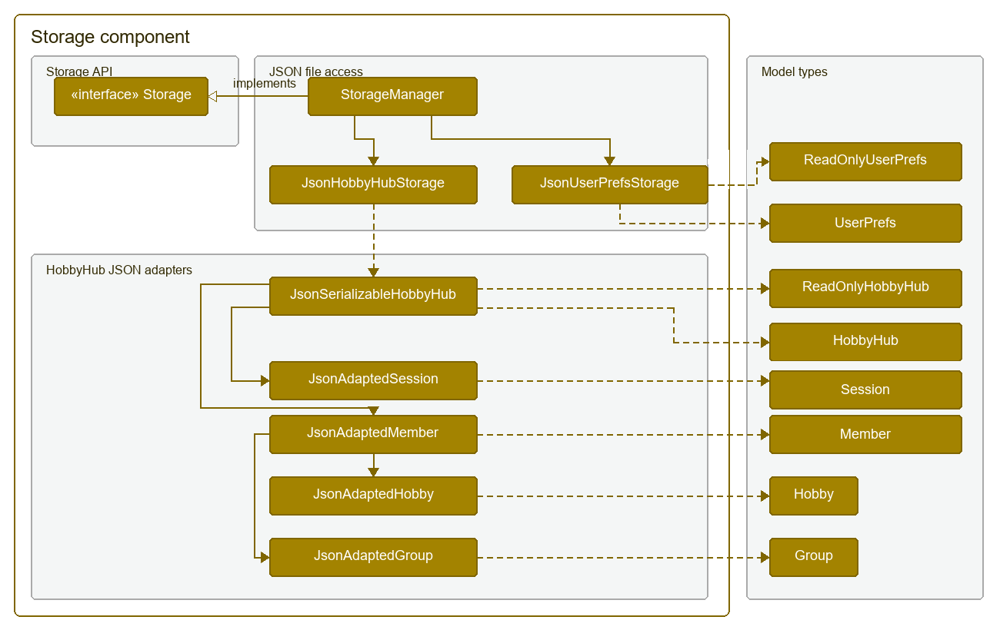
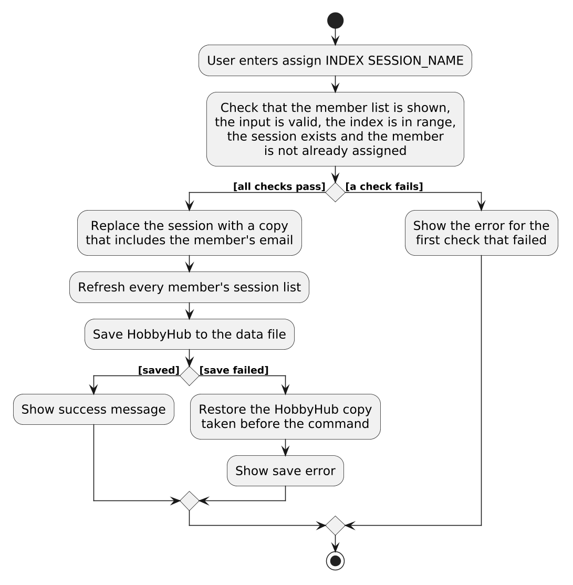

* Table of Contents
{:toc}

--------------------------------------------------------------------------------------------------------------------

## **Acknowledgements**

* HobbyHub was adapted from the [AddressBook-Level3 project by SE-EDU](https://github.com/se-edu/addressbook-level3).
* The Developer Guide structure and PlantUML conventions were adapted from the
  [SE-EDU documentation guides](https://se-education.org/guides/).

--------------------------------------------------------------------------------------------------------------------

## **Setting up, getting started**

Refer to the guide [_Setting up and getting started_](SettingUp.md).

--------------------------------------------------------------------------------------------------------------------

## **Design**

:bulb: **Tip:** The `.puml` files used to create diagrams are in `docs/diagrams`. Refer to the [_PlantUML Tutorial_ at se-edu/guides](https://se-education.org/guides/tutorials/plantUml.html) to learn how to create and edit diagrams.

### Architecture

The ***Architecture Diagram*** above explains the high-level design of HobbyHub. Component names describe
responsibilities rather than specific implementations, so the diagram remains accurate when implementation details
change.

The following provides a quick overview of the main components and their interactions.

**Main components of the architecture**

**`Main`** (consisting of classes [`Main`](../src/main/java/seedu/hobbyhub/Main.java) and
[`MainApp`](../src/main/java/seedu/hobbyhub/MainApp.java)) is in charge of app launch and shut down.
* At app launch, it initializes the other components in the correct sequence, and connects them up with each other.
* At shut down, it shuts down the other components and invokes cleanup methods where necessary.

The bulk of the app's work is done by the following four components:

* [**`UI`**](#ui-component): Accepts commands and presents members, hobbies, groups, and sessions to the user.
* [**`Logic`**](#logic-component): Parses and executes commands.
* [**`Model`**](#model-component): Holds HobbyHub's members, hobbies, groups, sessions, and user preferences in memory.
* [**`Storage`**](#storage-component): Loads and saves HobbyHub data and user preferences as local JSON files.

[**`Commons`**](#common-classes) represents a collection of classes used by multiple other components.

**How the architecture components interact with each other**

The *Sequence Diagram* below shows how the components interact with each other for the scenario where the user issues the command `delete 1`.

Each of the four main components (also shown in the diagram above),

* defines its *API* in an `interface` with the same name as the Component.
* provides its functionality through a concrete `{Component Name}Manager` class that implements the corresponding API interface.

For example, the `Logic` component defines its API in `Logic.java` and implements it in `LogicManager.java`. Other components interact with a component through its interface rather than its concrete class, preventing them from coupling to that component's implementation, as illustrated in the following partial class diagram.

The sections below give more details of each component.

### UI component

The **API** of this component is specified in [`Ui.java`](../src/main/java/seedu/hobbyhub/ui/Ui.java).

The UI consists of a `MainWindow` and its parts, including `CommandBox`, `ResultDisplay`,
`MemberListPanel`, `SessionListPanel`, `ViewDetailsPanel`, and `StatusBarFooter`. The list panels use
`MemberCard` and `SessionCard` objects to display the corresponding model objects. These visible parts,
including `MainWindow`, inherit from the abstract `UiPart` class, which captures their common behavior.

The `UI` component uses the JavaFX UI framework. The layouts of these UI parts are defined in matching `.fxml`
files in `src/main/resources/view`. For example, [`MainWindow.fxml`](../src/main/resources/view/MainWindow.fxml)
specifies the layout of [`MainWindow`](../src/main/java/seedu/hobbyhub/ui/MainWindow.java).

The `UI` component,

* executes user commands using the `Logic` component.
* listens for changes to `Model` data so that the UI can be updated with the modified data.
* keeps a reference to the `Logic` component, because the `UI` relies on the `Logic` to execute commands.
* depends on some classes in the `Model` component because it displays `Member` and `Session` objects.

### Logic component

**API** : [`Logic.java`](../src/main/java/seedu/hobbyhub/logic/Logic.java)

Here's a partial class diagram of the `Logic` component, showing member and session search as concrete examples. Other commands, parsers, and search predicate classes are omitted for clarity:

`LogicManager` holds a `HobbyHubParser`, a `Model`, and a `Storage`. For `search`, `HobbyHubParser` creates both `SearchCommandParser` and `SearchSessionCommandParser`, then uses the active `ListState` to select which parser handles the arguments. The selected parser creates a `SearchCommand` for members or a `SearchSessionCommand` for sessions. Both commands extend `Command`, update the corresponding model list's filter, and create a `CommandResult` containing the number of matches. `LogicManager` executes the command, saves the HobbyHub data through `Storage`, and returns the result.

The sequence diagram below illustrates the interactions within the `Logic` component, taking `execute("delete 1")` API call as an example.

:information_source: **Note:** The lifeline for `DeleteCommandParser` should end at the destroy marker (X), but due to a limitation of PlantUML, it continues to the end of the diagram.

How the `Logic` component works:

1. When `Logic` is called upon to execute a command, `LogicManager` passes the command text and the model's active `ListState` to `HobbyHubParser`. For commands that act on the current list, it creates member and session parsers, then selects the appropriate parser to parse the arguments.
1. This results in a `Command` object (more precisely, an object of one of its subclasses e.g., `DeleteCommand`) which is executed by the `LogicManager`.
1. The command can communicate with the `Model` when it is executed (e.g. to delete a member). 
   Note that although this is shown as a single step in the diagram above for simplicity, the code can require several interactions between the command object and the `Model` to complete the operation.
1. The result of the command execution is encapsulated as a `CommandResult` object which is returned from `Logic`.

Here are the other classes in `Logic` (omitted from the class diagram above) that are used for parsing a user command:

How the parsing works:
* When called upon to parse a user command, the `HobbyHubParser` class creates an `XYZCommandParser` (`XYZ` is a placeholder for the specific command name, e.g., `AddCommandParser`). The parser uses supporting parsing classes to parse the arguments and create an `XYZCommand` object (e.g., `AddCommand`). `HobbyHubParser` returns that object as a `Command` object. For search, the member and session parsers share `SearchArgument` to validate options and extract queries, then construct the search predicates.
* All `XYZCommandParser` classes, such as `AddCommandParser` and `DeleteCommandParser`, implement the `Parser` interface so they can be treated similarly where appropriate, for example during testing.

### Model component
**API** : [`Model.java`](../src/main/java/seedu/hobbyhub/model/Model.java)

The `Model` component,

* stores the HobbyHub data i.e., all `Member` objects (contained in a `UniqueMemberList` object) and all `Session` objects (contained in a `UniqueSessionList` object). A `Session` refers to its members by their `Email`.
* stores the `Member` and `Session` objects selected by the current filter, such as search results, in separate _filtered_ lists. It exposes these as unmodifiable `ObservableList`s that the UI can observe and bind to, so the UI updates when the lists change.
* stores the `ListState`, i.e., whether the member list or the session list is shown.
* stores a `UserPrefs` object that represents the user’s preferences (currently, just the GUI settings). This is exposed to the outside as a `ReadOnlyUserPrefs` object.
* does not depend on any of the other three components (as the `Model` represents data entities of the domain, they should make sense on their own without depending on other components)

### Storage component

**API** : [`Storage.java`](../src/main/java/seedu/hobbyhub/storage/Storage.java)

The `Storage` component,
* reads and writes the HobbyHub data and user preferences as JSON files. `StorageManager` implements the `Storage` API and delegates each data type to its own file-access class: `JsonHobbyHubStorage` and `JsonUserPrefsStorage`.
* converts HobbyHub data between model objects and JSON-friendly objects. `JsonSerializableHobbyHub` holds adapted
  members and sessions; each adapted member in turn contains adapted hobbies, groups, and availability values. On
  loading, these adapters validate and reconstruct the model objects.
* depends on model types such as `ReadOnlyHobbyHub`, `Member`, `Session`, and `UserPrefs` because it persists and restores the application's data.
* is guarded on startup by `MainApp`, which asks `InstanceLock` to acquire an exclusive lock associated with the
  configured HobbyHub data-file path. If another process already holds the lock, the new instance exits. If the
  operating system reports an I/O error while creating or acquiring the lock, HobbyHub logs a warning and continues;
  therefore, the lock is a best-effort safeguard rather than an absolute guarantee.

### Common classes

Classes used by multiple components are in the `seedu.hobbyhub.commons` package.

--------------------------------------------------------------------------------------------------------------------

## **Implementation**

This section describes some noteworthy details on how certain features are implemented.

### Member and session search with combined criteria

The model stores the active view in `ListState.MEMBERS` or `ListState.SESSIONS`.
`list -m` and `list -s` switch this state and show all records of the selected type;
plain `list` resets the current list's filter without switching views.
`LogicManager` passes the active state to `HobbyHubParser`, which routes `search` to
`SearchCommandParser` or `SearchSessionCommandParser`.

Both parsers use `SearchArgument` to require one or more distinct supported options with non-empty queries.
The parser separates options outside double quotes and returns them in prefix order.
This also rejects repeated options and unknown options outside quoted text, while preserving quoted option-like text.
Canonical prefix order gives equivalent combinations a consistent predicate representation regardless of input order.
Email queries are validated by `ParserUtil.parseEmail`, skill levels against `SkillLevel`,
and dates against the `YYYY-MM-DD` format and `LocalDate` calendar validation.
Completion queries accept only `true` or `false`, ignoring case.

Member search supports name (`-n`), hobby name (`-h`), group (`-g`), email (`-c`), skill level (`-sl`),
and weekday availability (`-d`).
Name, hobby and group searches use case-insensitive substring matching.
Hobby matching examines every hobby name, independently of groups.
Skill matching without a hobby criterion succeeds if any hobby has the requested level.
When hobby and skill are both supplied, `HobbyAndSkillPredicate` requires one hobby to satisfy both criteria.
Thus Chess:Beginner and Tennis:Advanced cannot satisfy a Chess + Advanced search.
Email matching compares the complete address, ignoring case.

Session search supports name (`-n`), location (`-l`), date (`-t`), completion status (`-done`),
and participant email (`-c`). Name and location use case-insensitive substring matching.
Date matching compares the session's local calendar date, ignoring its time.
Participant matching compares the complete email against the session's assigned emails, ignoring case.

Each criterion is converted to a validated predicate. A single predicate is used directly;
multiple predicates are combined in an immutable `AllMatchPredicate`, which requires every condition to match.
Hobby and skill form one paired predicate when both are present. All remaining fields are independent conditions.
`SearchCommand` and `SearchSessionCommand` replace the predicate of the corresponding model filtered list.
The UI observes that list and displays matching records using its existing cards.
The command returns a result count, including zero for an empty result list.
Search preserves stored data, the active state, and the other list's filter.
Each new search examines all records of its type rather than only the previous search results.

Combined criteria implement US12 for members and support the corresponding session search workflow.
Invalid combinations are rejected before execution, preserving both the previous filter and stored data.
Availability search (part of US11) matches members whose stored weekday set contains the requested day.
Availability is informational and is not checked when a member is assigned to a session. Phone and address are
outside search scope.

### Transactional persistence and single-instance coordination

Before executing a command, `LogicManager` copies the current `HobbyHub` state. After successful command execution,
it asks `Storage` to save the updated state. If saving fails, `LogicManager` restores the copy and reports the
persistence error, so the in-memory model and the previously saved file do not diverge because of a partial command.

At startup, `MainApp` calls `InstanceLock.tryAcquire` using the configured HobbyHub data-file path. The lock is held
for the application's lifetime and released during shutdown. A second process that can see the held lock exits before
loading the model. If lock acquisition itself fails with an `IOException`, HobbyHub logs the failure and starts without
the guard so that file-system limitations do not prevent the application from opening.

### Assigning and unassigning members to sessions

`assign INDEX SESSION_NAME` adds the member at `INDEX` in the displayed member list to an existing session, and
`unassign INDEX SESSION_NAME` removes them again. Both commands are only available while the member list is shown.

#### How it works

A `Session` does not hold `Member` objects. It stores the `Email` of each assigned member in a `Set<Email>`.
Each `Member` in turn holds the list of sessions it is assigned to, which `HobbyHub` rebuilds from the session list
whenever members or sessions change.

The sequence diagram below shows how the `Logic` component parses and executes `assign 1 Weekend Chess Meetup`.
After the command returns, `LogicManager` saves the data as described in the previous section, so saving is not
shown again here.

:information_source: **Note:** The lifeline for `AssignCommandParser` should end at the destroy marker (X), but due to a limitation of PlantUML, it continues to the end of the diagram.

The next sequence diagram shows what `AssignCommand#execute` does inside the `Model` component.

The activity diagram below summarises the overall flow of `assign`. The checks are the ones listed in the steps
above; each failed check shows its own error message and leaves the data unchanged.

1. `LogicManager` passes the command text and the active `ListState` to `HobbyHubParser#parseCommand`.
   If the session list is shown, `HobbyHubParser` rejects `assign` before creating a parser.
1. `AssignCommandParser` splits the arguments into the first word (the index) and the rest (the session name).
   It parses the index with `ParserUtil#parseIndex`, checks the name with `SessionName#isValidSessionName`,
   and creates an `AssignCommand`.
1. `AssignCommand#execute` checks again that `ListState` is `MEMBERS`, then gets the member at the index from the
   filtered member list.
1. It finds the session in `HobbyHub#getSessionList()` whose `SessionName` equals the given name.
   `SessionName#equals` ignores case, so `assign 1 weekend chess meetup` finds the same session.
1. If the session already contains the member's email, the command fails. Otherwise it calls
   `Session#withMember(email)`, which returns a new `Session` with the email added, and replaces the old session
   through `Model#setSession`.
1. `HobbyHub#setSession` calls `refreshMemberSessions()`, which gives every member whose assigned sessions changed
   an updated copy of themselves. This is how the member card and `view` show the new session.
1. `LogicManager` saves the data through `Storage`. If saving fails, it restores the copy of `HobbyHub` taken before
   the command, as described in the previous section.

`unassign` follows the same steps, except that it fails if the member is not assigned to the session and it uses
`Session#withoutMember(email)` instead of `withMember`.

The command fails without changing any data when:
* the session list is shown instead of the member list,
* the index is not a positive integer or is larger than the displayed member list,
* the session name is invalid or no session has that name,
* the member is already assigned (`assign`) or not assigned (`unassign`) to that session.

Because sessions refer to members by email, other member commands keep the links up to date:
* `HobbyHub#setMember` replaces the old email with the new one in every session when an edit changes a member's email.
* `HobbyHub#removeMember` removes the deleted member's email from every session.
* Deleting a session removes it from every member through `refreshMemberSessions()`.

#### Design considerations

**Aspect: How a session refers to its members**

* **Alternative 1 (current choice):** Store each member's `Email`.
  * Pros: `Member` and `Session` are immutable, and an edited member is a new object. Emails stay valid across edits,
    are unique among members, and are easy to save to and load from JSON.
  * Cons: Sessions must be updated when a member's email changes or the member is deleted, and each member's session
    list has to be rebuilt after changes.

  The object diagram below shows the objects after `assign 1 Weekend Chess Meetup`. The session refers to members
  only through their `Email` objects; each member's list of sessions is rebuilt by
  `HobbyHub#refreshMemberSessions()`. Because `Session` and `Member` are immutable, `assign` does not change the
  existing objects: it replaces the session with a new one that includes Alice's email, and `refreshMemberSessions()`
  replaces Alice with a new `Member` whose session list includes the new session.
  For simplicity, the `HobbyHub`, `UniqueMemberList` and `UniqueSessionList` objects that hold these members and the
  session are omitted.

  

* **Alternative 2:** Store references to `Member` objects.
  * Pros: A session can read its members' details directly.
  * Cons: Every edit creates a new `Member`, so sessions would hold out-of-date objects unless every edit also
    updated all sessions. Saving would also need a separate identifier for each member.

**Aspect: How the session is identified in the command**

* **Alternative 1 (current choice):** By session name, as in `assign 1 Weekend Chess Meetup`.
  * Pros: Works while the member list is shown, without switching lists. Session names are unique, ignoring case.
  * Cons: Users must type the full name.
* **Alternative 2:** By the session's index in the session list, as in `assign 1 2`.
  * Pros: Shorter to type.
  * Cons: Only one list is shown at a time, so the user cannot see the session index while picking a member.
    Indexes also change with each search or list.

--------------------------------------------------------------------------------------------------------------------

## **Documentation, logging, testing, dev-ops**

* [Documentation guide](Documentation.md)
* [Testing guide](Testing.md)
* [Logging guide](Logging.md)
* [DevOps guide](DevOps.md)

--------------------------------------------------------------------------------------------------------------------

## **Appendix: Requirements**

### Product scope

**Target user profile**:

A single community hobby-group coordinator who
* manages prospective and existing members of one or more hobby groups
* records member contact details, hobbies, skill levels, weekday availability and group labels
* needs to find suitable members when organising activities
* manually organises members using group labels and assigns members to sessions
* prefers fast, keyboard-driven workflows
* is reasonably comfortable using CLI applications
* does not require members to log in or access the application directly

**Value proposition**: Help a hobby-group coordinator manage members and sessions quickly from the keyboard by storing records locally, supporting combined searches, and recording group labels and session participation without relying on spreadsheets or remote services.

HobbyHub is a single-user, coordinator-driven tool. It does not provide member accounts or automated black-box matching.

### User stories

Priorities: High (must have) - `* * *`, Medium (nice to have) - `* *`, Low (optional) - `*`

Only user stories supported by the current release are listed below.

| Priority | ID | As a …​ | I want to …​ | So that I can…​ |
| -------- | -- | ------- | ------------ | ---------------- |
| `* * *` | US01 | coordinator | add a member with a name, optional phone number, email, optional address, hobbies, groups and availability | maintain an up-to-date member list |
| `* * *` | US02 | coordinator | list all members | view the members currently under my management |
| `* * *` | US03 | coordinator | delete a member by their displayed index | keep the member list accurate |
| `* * *` | US04 | coordinator | search for members by name using case-insensitive partial matching | retrieve a member quickly |
| `* * *` | US05 | coordinator | search members by hobby name | focus on members interested in a particular activity |
| `* * *` | US06 | coordinator | save member and session data automatically after successful commands and restore it on restart | avoid losing records between application sessions |
| `* * *` | US07 | coordinator | exit the application cleanly | close the application without losing saved data |
| `* *` | US08 | coordinator | view a member's complete profile | understand the member's interests and participation needs |
| `* *` | US09 | coordinator | edit a member's information | correct outdated or inaccurate records |
| `* *` | US10 | coordinator | record a member's hobbies, skill level and availability | identify suitable participants for activities |
| `* *` | US11 | coordinator | filter members by availability and skill level | identify members suitable for a planned activity |
| `* *` | US12 | coordinator | combine several search criteria | narrow down a large member list efficiently |
| `* *` | US13 | coordinator | record a session | keep track of sessions that I have arranged |
| `* *` | US14 | coordinator | view a member's current sessions | know which sessions may be affected by a change |
| `* *` | US15 | coordinator | remove an existing session | correct an outdated or unsuccessful pairing |
| `* *` | US16 | coordinator | create and assign members to hobby groups | manage group participation |
| `* *` | US17 | coordinator | view a member's group memberships | know which activities the member is involved in |
| `*` | US18 | coordinator | perform partial searches | find members without knowing the exact spelling |
| `*` | US19 | coordinator | store multiple hobbies | represent a more complete member profile |
| `*` | US20 | coordinator | validate email addresses | keep stored contact information consistent |

### Use cases

(For all use cases below, the **System** is `HobbyHub` and the **Actor** is the `coordinator`, unless specified otherwise.)

Indices refer to the currently displayed list, including search results. Commands that act on a list are
interpreted according to the active member or session view. Unless stated otherwise, a rejected input changes
neither stored records nor the current search results. A save failure is reported as a command error, and
HobbyHub restores its in-memory member and session data to the state before the command. This rollback does
not guarantee restoration of the previous view or search filter, or an unchanged file after a failed write.

**Use case: UC01 - Add a member**

**Preconditions**

* HobbyHub is running and the member list is active (`list -m`).

**MSS**

1. Coordinator requests to add a member, supplying a name, email and at least one hobby, optionally with skill levels,
   phone, address, groups and weekday availability.
2. HobbyHub validates the supplied fields and options.
3. HobbyHub verifies that no existing member has the same email, ignoring case.
4. HobbyHub adds the member.
5. HobbyHub saves the updated data.
6. HobbyHub reports the successful addition.

   Use case ends.

**Guarantees**

* A successful addition is retained after restart and is available to member listings and searches.
* Omitted phone and address are stored as absent values; omitted groups and availability are empty.
* A hobby without a skill suffix defaults to Beginner.

**Extensions**

* 2a. A required field is missing, a value is invalid, an option is unsupported, or a single-valued option is repeated.

  * 2a1. HobbyHub reports the format or validation error and adds no member.

    Use case ends.

* 3a. Another member already has the supplied email, ignoring case.

  * 3a1. HobbyHub reports the duplicate email and adds no member.

    Use case ends.

* 5a. HobbyHub cannot save the updated data.

  * 5a1. HobbyHub restores the previous in-memory records and reports the save failure.

    Use case ends.

**Use case: UC02 - List members or sessions**

**Preconditions**

* HobbyHub is running.

**MSS**

1. Coordinator requests the complete member list using `list -m`.
2. HobbyHub switches to the member view and clears its search filter.
3. HobbyHub displays all members and reports that all members have been listed.

   Use case ends.

**Guarantees**

* Member and session records are unchanged.
* The selected list displays all its records, including when that list is empty.

**Extensions**

* 1a. Coordinator requests `list -s` instead.

  * 1a1. HobbyHub switches to sessions, clears the session filter and displays all sessions with list feedback.

    Use case ends.

**Use case: UC02 - List all members**

**Preconditions**

* HobbyHub is running and the member list is active (`list -m`).

**MSS**

1. Coordinator lists members (UC02) or searches for members (UC05).
2. HobbyHub displays the matching members with index numbers.
3. Coordinator requests deletion using a displayed member index.
4. HobbyHub validates the index.
5. HobbyHub deletes the member and removes their email from every assigned session.
6. HobbyHub saves the updated data.
7. HobbyHub reports the successful deletion.

   Use case ends.

**Guarantees**

* After successful deletion, the member remains absent after restart.
* The sessions themselves remain, with their participant lists updated.
* No confirmation dialog is required before deletion.

**Extensions**

* 4a. The index is missing, not a positive integer, or outside the displayed list, including an empty list.

  * 4a1. HobbyHub reports the format or index error and deletes nothing.

    Use case ends.

* 6a. HobbyHub cannot save the updated data.

  * 2a1. HobbyHub displays an empty member list and reports that all members have been listed.

    Use case ends.

For session deletion, the same interaction applies in the session view, using UC02 or UC08 to locate the session.
Deleting a session removes that session from every assigned member's session details while retaining the members.

**Use case: UC04 - View a member**

**Preconditions**

* HobbyHub is running and the member list is active (`list -m`).

**MSS**

1. Coordinator requests to list members, or searches for members (UC05).
2. HobbyHub shows the displayed member list, each member with an index number.
3. Coordinator requests to delete the member at a specific index in the displayed list.
4. HobbyHub validates the index.
5. HobbyHub shows the member's name, email, phone, address, hobbies and skill levels, groups, availability and assigned
   sessions in command feedback and the details panel.

   Use case ends.

**Guarantees**

* Member and session records are unchanged.
* All assigned sessions are included, whether completed or not.

**Extensions**

* 4a. The index is missing, not a positive integer, or outside the displayed list, including an empty list.

  * 4a1. HobbyHub reports the format or index error and does not show a new record.

    Use case ends.

For session viewing, the same interaction applies in the session view, using UC02 or UC08 to locate the session.
HobbyHub shows the session name, date-time, location, completion status and assigned participant emails.

**Use case: UC05 - Search members by one or more criteria**

**Preconditions**

* HobbyHub is running and the member list is active (`list -m`).

**MSS**

1. Coordinator requests a search with one or more distinct name, hobby, group, email, skill-level or weekday-availability
   options and their queries.
2. HobbyHub validates every option and its non-empty query.
3. HobbyHub searches all members, requiring every supplied criterion to match.
4. HobbyHub displays the matching members and the result count.

   Use case ends.

**Guarantees**

    * 6a1. HobbyHub reports the persistence failure.
    * 6a2. HobbyHub restores the in-memory model to its state before the command and preserves the previously
      persisted member data.

**Extensions**

* 2a. No criteria are supplied, an option is repeated or unsupported, or a query is missing or invalid.

  * 2a1. HobbyHub reports the format or validation error and leaves the existing results unchanged.

    Use case ends.

* 3a. No members match all supplied criteria.

  * 3a1. HobbyHub displays an empty member list and reports zero members listed.

    Use case ends.

**Use case: UC06 - Persist and restore member and session data**

**Preconditions**

* HobbyHub is running.

**MSS**

1. Coordinator submits a valid command.
2. HobbyHub executes the command and saves the current member and session data to its local JSON file.
3. Coordinator closes and relaunches HobbyHub.
4. HobbyHub loads and validates the saved members and sessions, resolving session participants by email.
5. HobbyHub restores the records and assignments for continued use.

   Use case ends.

**Guarantees**

* All member records remain unchanged.
* Member details are accurately displayed.

**Extensions**

* 2a. HobbyHub cannot create or write the data file.

  * 2a1. HobbyHub restores its in-memory records to their state before the command and reports the save failure.

    Use case ends.

* 4a. The data file is missing.

  * 4a1. HobbyHub starts with sample data and logs that the saved file was not found.

    Use case ends.

* 4b. The file contains invalid, malformed or duplicate member or session entries, but its root is a valid JSON object.

  * 4b1. HobbyHub skips the invalid entries, logs the problems and attempts to create a timestamped backup alongside
    the original file. A backup failure is logged without preventing startup.
  * 4b2. HobbyHub restores the remaining valid records. The next successful save writes this recovered dataset.

    Use case ends.

* 4c. The file cannot be read, is malformed JSON, or has a root that is not a JSON object.

  * 4c1. HobbyHub logs the loading failure and starts with empty member and session lists.
  * 4c2. The next successful save writes the current dataset; the malformed-file path does not automatically create
    a recovery backup.

    Use case ends.

* 4d. A session refers to an email that matches no loaded member.

**Use case: UC05 - Search members by one or more criteria**

**Preconditions**

* HobbyHub is running.

**MSS**

1. Coordinator submits `exit`.
2. HobbyHub saves the current data and returns an exit result.
3. HobbyHub closes its windows, attempts to save user preferences, releases its data-file lock if held and terminates.

   Use case ends.

**Guarantees**

* Previously saved member and session records remain available for the next launch.
* Additional arguments after `exit` are ignored.

**Extensions**

* 2a. HobbyHub cannot save the current data.

  * 2a1. HobbyHub reports the save failure and does not return the exit result, so the application remains open.

    Use case ends.

* 3a. User preferences cannot be saved or the held lock cannot be released normally.

  * 3a1. HobbyHub logs the failure and continues shutdown.

    Use case ends.

**Use case: UC08 - Search sessions by one or more criteria**

**Preconditions**

* HobbyHub is running and the session list is active (`list -s`).

**MSS**

1. Coordinator initiates a member search.
2. Coordinator supplies one or more distinct name, hobby, group, email, skill-level, or availability options.
3. HobbyHub validates the search term.
4. HobbyHub identifies members matching all supplied criteria, ignoring letter case. Names, hobbies and groups
   use substring matching; emails match in full; availability matches a stored weekday. When hobby and skill are
   combined, both must match one hobby.
5. HobbyHub returns the matching member records to the coordinator.

   Use case ends.

**Guarantees**

* Name and location matching is case-insensitive and partial.
* Dates match the whole calendar day, ignoring time, and completion status matches the stored boolean.
* Participant emails match complete addresses, ignoring case.
* Each search replaces the session filter; stored records, the active view and the member filter are unchanged.

**Extensions**

* 2a. No criteria are supplied, an option is repeated or unsupported, or a query is missing or invalid.

  * 2a1. HobbyHub reports the format or validation error and leaves the existing results unchanged.

    Use case ends.

    Use case ends.

* 1b. The coordinator repeats an option.

  * 1b1. HobbyHub reports the invalid format; each option can be supplied only once.
  * 1b2. HobbyHub does not perform a search.

    Use case ends.

**Use case: UC09 - Edit a member or session**

**Preconditions**

* HobbyHub is running and the appropriate member or session list is active.

**MSS**

1. Coordinator requests an edit, supplying a displayed index and at least one field to change.
2. HobbyHub validates the index, options and supplied values.
3. HobbyHub updates the specified fields and preserves omitted fields.
4. HobbyHub saves the updated records.
5. HobbyHub displays all records of the edited type and reports the successful edit.

   Use case ends.

**Guarantees**

* Editing member hobbies, groups or availability replaces the entire corresponding collection.
* Changing a member's email updates their participant email in assigned sessions.
* Session edits change only date-time and location, preserving the name, completion status and assignments.
* A successful edit is retained after restart.

**Extensions**

* 2a. No field is supplied, the index is invalid, an option is unsupported, a single-valued option is repeated, or a
  supplied value is invalid.

  * 2a1. HobbyHub reports the format, index or validation error and changes no records.

    Use case ends.

* 2b. The new member email belongs to another member, ignoring case.

  * 2b1. HobbyHub reports the duplicate email and changes no records.

    Use case ends.

* 2c. Coordinator supplies a single empty phone, address, group or availability option for a member.

  * 2c1. HobbyHub accepts the field as a request to clear that optional value or collection.

    Use case resumes at step 3.

* 2d. Coordinator supplies an empty member name, email or hobby, or an empty session field.

  * 2d1. HobbyHub reports the validation error and changes no records.

    Use case ends.

**Use case: UC06 - Persist and restore member data**

**Preconditions**

* HobbyHub is running and the session list is active (`list -s`).

**MSS**

1. Coordinator requests to add a session with a name, date-time and location.
2. HobbyHub validates the supplied options and values.
3. HobbyHub verifies that no existing session has the same name, ignoring case.
4. HobbyHub creates an incomplete session with no assigned members.
5. HobbyHub saves the updated data and reports the successful addition.

   Use case ends.

**Guarantees**

* Successfully persisted member data is retained between application sessions.
* Members, sessions, contact details, hobbies, groups, and availability are restored without unintended changes.
* No separate manual save command is required.

**Extensions**

* 2a. A required field is missing, a field value is invalid, an option is unsupported, or an option is repeated.

  * 2a1. HobbyHub reports that the data could not be saved.
  * 2a2. HobbyHub restores the in-memory model to its state before the command and leaves the previously saved file
    unchanged.

    Use case ends.

* 3a. Another session already has the supplied name, ignoring case.

  * 5a1. HobbyHub logs the loading failure and starts with an empty data model.
  * 5a2. HobbyHub does not claim that the previous data was restored.

    Use case ends.

* 5b. Individual member or session entries in an otherwise readable data file are invalid.

  * 5b1. HobbyHub discards invalid entries, loads the remaining valid entries, logs a warning, and creates a
    timestamped backup of the original file.

    Use case resumes at step 6.

* 5c. The data file cannot be parsed as HobbyHub JSON.

  * 5c1. HobbyHub logs a warning and starts with an empty data model without crashing.

    Use case ends.

**Use case: UC11 - Assign or unassign a member from a session**

**Preconditions**

* HobbyHub is running and the member list is active (`list -m`).

**MSS**

1. Coordinator requests assignment using a displayed member index and an existing session name.
2. HobbyHub validates the index and finds the session by its name, ignoring case.
3. HobbyHub checks that the member is not already assigned.
4. HobbyHub adds the member's email to the session and refreshes members' assigned-session details.
5. HobbyHub saves the updated data and reports the successful assignment.

   Use case ends.

**Guarantees**

* The assignment appears in both the session's participants and the member's session details.
* Assignment does not check weekday availability, hobby suitability or time conflicts.

**Extensions**

* 2a. HobbyHub encounters an unexpected failure while terminating.

  * 3a1. HobbyHub reports the assignment-state error and changes no assignments.

    Use case ends.

Additional text after the `exit` command word is ignored.

**Use case: UC08 - Search sessions by one or more criteria**

**Preconditions**

* HobbyHub is running and the session list is active (`list -s`).

**MSS**

1. Coordinator requests to mark a displayed session index as completed.
2. HobbyHub validates the index and checks that the session is not already completed.
3. HobbyHub marks the session as completed.
4. HobbyHub saves the updated data and reports success.

   Use case ends.

**Guarantees**

* The session's name, date-time, location and assignments are preserved.
* Completion status is retained after a successful save and restart.

**Extensions**

* 1a. Coordinator requests to unmark a session instead.

  * 1a1. HobbyHub uses the same interaction, requiring a completed session and changing it to incomplete.

    Use case resumes at step 2 with the reversed completion-state check.

* 2a. The arguments or index are invalid, or the session already has the requested completion state.

  * 2a1. HobbyHub reports the format, index or completion-state error and changes no records.

    Use case ends.

* 4a. HobbyHub cannot save the updated data.

  * 4a1. HobbyHub restores the previous in-memory records and reports the save failure.

    Use case ends.

**Use case: UC09 - Edit a member or session**

**Preconditions**

* HobbyHub is running.
* The list to edit is shown (`list -m` for members or `list -s` for sessions).

**MSS**

1. Coordinator requests to edit a member or session in the displayed list, giving its index and the fields to change.
2. HobbyHub validates the index and the new values.
3. HobbyHub replaces the current value of each given field with its new value.
4. HobbyHub saves the data and shows the edited member or session. Use case ends.

**Guarantees**

* A rejected edit changes no data.
* An accepted edit changes only the fields given. Other fields, including a member’s assigned sessions, stay as they were.
* An accepted edit is saved to the JSON data file.

**Extensions**

* 2a. The index does not match any member or session in the displayed list.
  * 2a1. HobbyHub shows an error. Use case ends.
* 2b. No field to change is given.
  * 2b1. HobbyHub shows an error. Use case ends.
* 2c. A given value is invalid (e.g. a malformed phone number or date-time), or a single-valued field is given more than once.
  * 2c1. HobbyHub shows an error and changes nothing, even if other given values were valid. Use case ends.
* 2d. The new email belongs to another member.
  * 2d1. HobbyHub shows an error. Use case ends.
* 2e. Coordinator requests to clear a field, by giving the field without a value.
  * 2e1. If the field is optional (a member’s phone, address, groups or availability), HobbyHub clears it. Use case resumes at step 3.
  * 2e2. Otherwise (a member’s name, email or hobbies, or any session field), HobbyHub shows an error and changes nothing. Use case ends.
* 4a. HobbyHub cannot write to the data file.
  * 4a1. HobbyHub tells the coordinator that the data could not be saved and rolls back the edit. Use case ends.

### Non-Functional Requirements

| ID | Category | Requirement |
| --- | --- | --- |
| NFR01 | Portability | HobbyHub should run on Windows, macOS, and Linux systems with JDK 25 or later and the required JavaFX runtime. |
| NFR02 | Capacity| HobbyHub should support at least 1000 member records while preserving all MVP functionality. |
| NFR03 | Performance | For a local dataset of up to 1000 members, common operations such as adding a member, searching by name, and applying a basic filter should complete within two seconds under normal operations. |
| NFR04 | Usability | All core workflows should be usable through keyboard-driven commands without requiring mouse interaction or relying solely on colour, animation, or pointer-based interaction. |
| NFR05 | Availability | All MVP functions should work without requiring an Internet connection, remote API, or hosted database. |
| NFR06 | Privacy | Member data should remain on the coordinator's local machine. |
| NFR07 | Reliability | Invalid commands should not partially modify stored data. |
| NFR08 | Robustness | Validation and persistence failures should be reported clearly without causing the application to crash. |
| NFR09 | Data portability | Member data should be stored in a local, human-readable format that can be inspected or backed up using standard file-management tools. |
| NFR10 | Error clarity | Every invalid MVP command should produce an error message that identifies the invalid or missing input and, where applicable, states the expected format. |
| NFR11 | UI | The main window should remain usable at a minimum resolution of 1024 × 768 pixels, with no command input, result display, or member information clipped at that resolution. |

### Glossary

* **Mainstream OS**: Windows, Linux, Unix, or macOS
* **Private contact detail**: A contact detail that is not meant to be shared with others

--------------------------------------------------------------------------------------------------------------------

## **Appendix: Instructions for manual testing**

Given below are instructions to test the app manually.

:information_source: **Note:** These instructions only provide a starting point for testers to work on;
testers are expected to do more *exploratory* testing.

### Launch and shutdown

1. Initial launch

   1. Download the JAR file and copy it into an empty folder.

   1. Double-click the JAR file. 
      Expected: The GUI opens with sample members and sessions. The window size may not be optimal.

1. Saving window preferences

   1. Resize the window to an optimal size. Move the window to a different location. Close the window.

   1. Relaunch the app by double-clicking the JAR file. 
       Expected: The most recent window size and location are retained.

1. Preventing a second instance from using the same data file

   1. With the first instance still running, double-click the same JAR file again. 
      Expected: The second instance prints `Another HobbyHub instance is already running.` and exits. The first
      instance continues running. This check assumes the operating system supports creating and locking the lock file.

### Switching lists and deleting records

1. Deleting a member while all members are being shown

   1. Prerequisites: Show all members using `list -m`, with multiple members in the list.

   1. Test case: `delete 1` 
      Expected: The first member is deleted from the list. The status message shows the deleted member's details.

   1. Test case: `delete 0` 
      Expected: No member is deleted. The status message shows error details.

   1. Other incorrect delete commands to try: `delete`, `delete x`, `...` (where x is larger than the list size) 
      Expected: Similar to previous.

1. Deleting a session

   1. Prerequisites: Show all sessions using `list -s`, with at least one session in the list.

   1. Test case: `delete 1` 
      Expected: The first displayed session is deleted and the status message identifies it.

### Editing optional member fields

1. Clearing optional fields

   1. Prerequisites: Show all members using `list -m`, with at least one member in the list.

   1. Test case: `edit 1 -p -a -g -d` 
      Expected: The first member's phone, address, groups, and availability are cleared. Required fields and assigned
      sessions remain unchanged.

1. Rejecting an attempt to clear a required field

   1. Test case: `edit 1 -n` 
      Expected: The edit is rejected with the name constraint message, and the member remains unchanged.

### Saving data

1. Restoring saved data

   1. Add or edit a member, note the changed data, and exit HobbyHub.

   1. Relaunch HobbyHub from the same folder. 
      Expected: The changed member data is restored from `data/addressbook.json`.

1. Dealing with a missing data file

   1. Exit HobbyHub and move `data/addressbook.json` to another folder.

   1. Relaunch HobbyHub. 
      Expected: HobbyHub starts successfully with sample data and creates a new data file after the next successful
      command. Restore the moved file after finishing the test if its data is still needed.

1. Dealing with invalid entries in a readable data file

   1. Exit HobbyHub and make a backup copy of `data/addressbook.json`.

   1. In one member entry, replace the email value with an invalid string while keeping the JSON syntax valid.

   1. Relaunch HobbyHub. 
      Expected: HobbyHub starts, discards the invalid entry, loads the remaining valid entries, and creates a
      timestamped backup beside `data/addressbook.json`. Restore the manual backup after the test.

1. Dealing with malformed JSON

   1. Exit HobbyHub, back up `data/addressbook.json`, then replace its contents with text that is not valid JSON.

   1. Relaunch HobbyHub. 
      Expected: HobbyHub starts with an empty model and logs the loading error without crashing. Close the window
      using the title-bar close button without entering a command, then restore the backup to avoid replacing the
      original data with the empty model.
