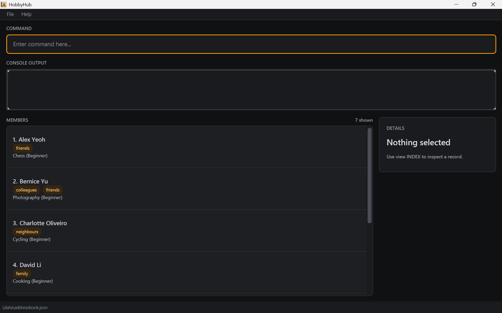

HobbyHub is a **desktop application for managing contacts, optimized for use through a Command Line Interface (CLI)** while retaining the benefits of a Graphical User Interface (GUI). If you type quickly, HobbyHub can help you manage contacts faster than traditional GUI applications.

* Table of Contents
{:toc}

--------------------------------------------------------------------------------------------------------------------

## Quick start

1. Ensure that Java `25` or later is installed on your computer. 
   **Mac users:** Ensure you have the precise JDK version prescribed [here](https://se-education.org/guides/tutorials/javaInstallationMac.html).

1. Download the latest `.jar` file from [here](https://github.com/se-edu/addressbook-level3/releases).

1. Copy the file to the folder you want to use as the _home folder_ for your HobbyHub.

1. Open a terminal, `cd` to the folder containing the JAR file, and run `java -jar addressbook.jar`. 
   A GUI similar to the one below should appear in a few seconds. Note how the app contains some sample data. 
   

1. Type a command in the command box and press Enter to execute it. For example, type **`help`** and press Enter to open the help window. 
   Some example commands you can try:

   * `list` : Lists all contacts.

   * `add -n John Doe -p 98765432 -c johnd@example.com -a John street, block 123, #01-01 -h Chess` : Adds a contact named `John Doe` to the Address Book.

   * `search -n John` : Finds members whose names contain `John`.

   * `search -h Chess` : Finds members whose hobbies contain `Chess`.

   * `delete 3` : Deletes the 3rd contact shown in the current list.

   * `clear` : Deletes all contacts.

   * `exit` : Exits the app.

1. Refer to the [Features](#features) section below for details of each command.

--------------------------------------------------------------------------------------------------------------------

## Features

**:information_source: Notes about the command format:** 

* Words in `UPPER_CASE` are the parameters to be supplied by the user. 
  For example, in `add -n NAME`, replace `NAME` with a value such as `John Doe`.

* Items in square brackets are optional. 
  For example, `-n NAME [-t TAG]` can be used as `-n John Doe -t friend` or as `-n John Doe`.

* Items followed by `…`​ can appear zero or more times. 
  For example, `[-t TAG]…​` may be omitted, or written as `-t friend` or `-t friend -t family`.

* Parameters can be in any order. 
  For example, if the command specifies `-n NAME -p PHONE_NUMBER`, `-p PHONE_NUMBER -n NAME` is also acceptable.

* Extraneous parameters for commands that take no parameters, such as `help`, `list`, `exit`, and `clear`, are ignored. 
  For example, `help 123` is interpreted as `help`.

* If you are using a PDF version of this document, be careful when copying and pasting commands that span multiple lines as space characters surrounding line-breaks may be omitted when copied over to the application.

### Viewing help: `help`

Shows a message explaining how to access the help page.

Format: `help`

### Adding a person: `add`

Adds a person to the address book.

Format: `add -n NAME -p PHONE_NUMBER -c EMAIL -a ADDRESS -h HOBBY [-t TAG]…​`

* Name, phone number, email, address, and hobby are all required and must not be empty.
* Supply each required option once. Only `-t` may be repeated to add multiple tags.
* Names must contain only letters, digits, and spaces. Phone numbers must contain at least three digits and no other characters.
* Use a valid email address, such as `johnd@example.com`. Each tag must contain only letters and digits.
* Hobbies must start with a letter or digit and may contain letters, digits, spaces, and `&`, `+`, `'`, `/`, or `-`.
* Multiword names, addresses, and hobbies do not need quotes; for example, `-h Board Games`.
* A person with the same name as an existing person cannot be added.

:bulb: **Tip:**
A person can have any number of tags, including zero.

Examples:
* `add -n John Doe -p 98765432 -c johnd@example.com -a John street, block 123, #01-01 -h Chess`
* `add -n Betsy Crowe -t friend -c betsycrowe@example.com -a Newgate Prison -p 1234567 -t criminal -h Chess`

### Listing all persons: `list`

Shows a list of all persons in the address book.

Format: `list`

### Editing a person: `edit`

Edits an existing person in the address book.

Format: `edit INDEX [-n NAME] [-p PHONE_NUMBER] [-c EMAIL] [-a ADDRESS] [-t TAG]…​`

* Edits the person at the specified `INDEX`. The index refers to the index number shown in the displayed person list. The index **must be a positive integer** 1, 2, 3, …​
* At least one of the optional fields must be provided.
* Existing values will be updated to the input values.
* When editing tags, all of the person's existing tags are removed; adding tags is not cumulative.
* To remove all of a person's tags, enter `-t` without a tag after it.
* Hobby cannot currently be changed with `edit`.

Examples:
* `edit 1 -p 91234567 -c johndoe@example.com` Edits the phone number and email address of the 1st person to be `91234567` and `johndoe@example.com` respectively.
* `edit 2 -n Betsy Crower -t` Edits the name of the 2nd person to be `Betsy Crower` and clears all existing tags.

### Searching members: `search`

Finds members whose names or hobbies contain the specified fragment.

Format: `search -n NAME_FRAGMENT` or `search -h HOBBY_FRAGMENT`

* The search is case-insensitive and supports partial matching; for example, `search -n hans` matches `Hans` and `Johannes`.
* Use exactly one search option: `-n` searches names and `-h` searches hobbies.
* A quoted fragment may contain spaces, such as `search -n "Alice Bob"` or `search -h "Board Games"`.
* Search terms that do not match any member return an empty result list.

Examples:
* `search -n John` finds members whose names contain `John`.
* `search -h chess` finds members whose hobbies contain `chess`.

### Deleting a person: `delete`

Deletes the specified person from the address book.

Format: `delete INDEX`

* Deletes the person at the specified `INDEX`.
* The index refers to the index number shown in the displayed person list.
* The index **must be a positive integer** 1, 2, 3, …​

Examples:
* `list` followed by `delete 2` deletes the 2nd person in the address book.
* `search -n Betsy` followed by `delete 1` deletes the 1st person in the search results.

### Removing a member by contact email: `remove`

Format: `remove -c EMAIL`

Removes the member whose email matches `EMAIL`, ignoring capitalization. The command searches
all stored members, including members hidden by the current search filter. Removal is immediate
and saved automatically.

Only one `-c` option is accepted. Missing or invalid emails, extra arguments, unexpected options,
and repeated `-c` options are rejected. An email may optionally be enclosed in double quotes.
If no member matches, an error is shown. If multiple members share the email, no member is removed;
use `list` and `delete INDEX` to resolve the duplicate records first.

Example: `remove -c alexyeoh@example.com`

### Clearing all entries: `clear`

Clears all entries from the address book.

Format: `clear`

### Exiting the program: `exit`

Exits the program.

Format: `exit`

### Saving the data

HobbyHub automatically saves data after every successful command. You do not need to save manually.

### Editing the data file

HobbyHub data is saved automatically as a JSON file `[JAR file location]/data/addressbook.json`. Advanced users are welcome to update data directly by editing that data file.

:exclamation: **Caution:**
If your changes make the data file invalid, HobbyHub starts with an empty address book at the next run. The invalid file remains on disk until you run a successful command (HobbyHub saves after every successful command). Still, we recommend backing up the file before editing it. 
Furthermore, certain edits can cause HobbyHub to behave in unexpected ways (e.g., if a value entered is outside of the acceptable range). Therefore, edit the data file only if you are confident that you can update it correctly.

### Archiving data files `[coming in v2.0]`

_Details coming soon ..._

--------------------------------------------------------------------------------------------------------------------

## FAQ

**Q**: How do I transfer my data to another computer? 
**A**: Install the app on the other computer and overwrite the data file it creates with the data file from your previous HobbyHub home folder.

--------------------------------------------------------------------------------------------------------------------

## Known issues

1. **When using multiple screens**, if you move the application to a secondary screen, and later switch to using only the primary screen, the GUI will open off-screen. The remedy is to delete the `preferences.json` file created by the application before running the application again.
2. **If you minimize the Help Window** and then run the `help` command (or use the `Help` menu, or the keyboard shortcut `F1`) again, the original Help Window will remain minimized, and no new Help Window will appear. The remedy is to manually restore the minimized Help Window.

--------------------------------------------------------------------------------------------------------------------

## Command summary

Action | Format, Examples
--------|------------------
**Add** | `add -n NAME -p PHONE_NUMBER -c EMAIL -a ADDRESS -h HOBBY [-t TAG]…​`   e.g., `add -n James Ho -p 22224444 -c jamesho@example.com -a 123, Clementi Rd, 1234665 -t friend -t colleague -h Chess`
**Clear** | `clear`
**Remove** | `remove -c EMAIL`  e.g., `remove -c alexyeoh@example.com`
**Delete** | `delete INDEX`  e.g., `delete 3`
**Edit** | `edit INDEX [-n NAME] [-p PHONE_NUMBER] [-c EMAIL] [-a ADDRESS] [-t TAG]…​`  e.g., `edit 2 -n James Lee -c jameslee@example.com`
**Search** | `search -n NAME_FRAGMENT` or `search -h HOBBY_FRAGMENT`  e.g., `search -n James` or `search -h Chess`
**List** | `list`
**Help** | `help`
**Exit** | `exit`
